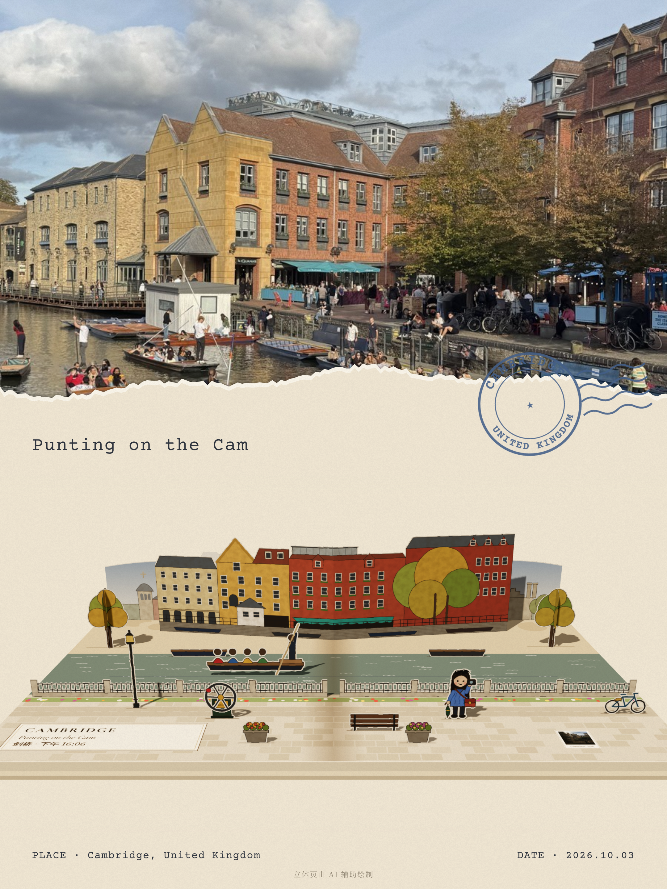
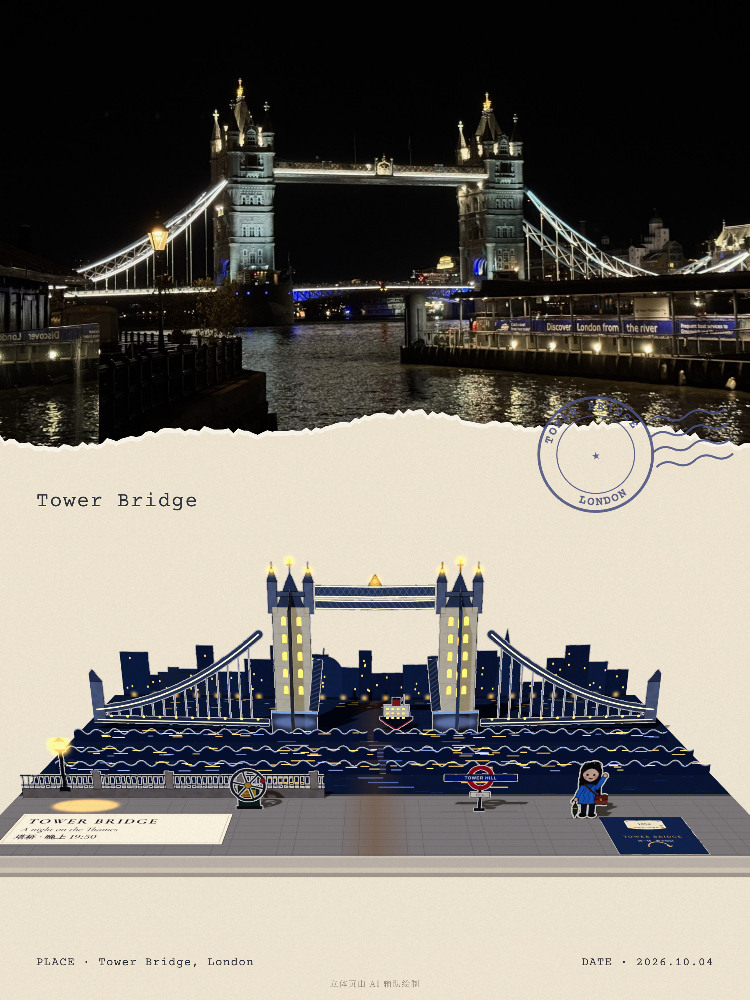

# Pop-up-book · 照片转纸艺立体书分享图

| 剑桥 · 康河撑船 | 伦敦 · 塔桥之夜 |
|---|---|
|  |  |

*效果示例：SVG 手绘纸片 + page.js + 3D 渲染 + 分享图合成；本 skill 已恢复此流程。*


将用户照片手绘为 SVG 纸片，在 `page.js` 中安排底页、V 折、立片和机关，再通过 three.js 渲染并合成分享图。无需图像生成模型或 API 密钥。输出 `page.js`、`popup.png`、`card.png`，还可在本机打开互动版。折纸检查是近似检查，不等于可制作图纸。

## 安装

Claude Code：

```bash
git clone https://github.com/trista977/Pop-up-book ~/.claude/skills/popup-page
cd ~/.claude/skills/popup-page
npm install
npm run setup
```

Codex 可把仓库安装到 `~/.codex/skills/popup-page`；其他支持 `SKILL.md` 的工具按其技能目录安装。需要 Node 18+、Playwright Chromium；HEIC 可通过 macOS sips、heif-convert 或 pillow-heif 转换。

## 使用

对助手说“用这张照片做一张立体书分享图”。助手按 [SKILL.md](SKILL.md) 手绘 page.js、检查、3D 渲染并合成 `card.png`。

```bash
mkdir -p popup-pages/my-trip
cp /path/to/your-photo.jpg popup-pages/my-trip/photo.jpg
node scripts/make.mjs popup-pages/my-trip
cp templates/page.js popup-pages/my-trip/page.js
# 按照片重画模板纸片并填写 page.js；不要直接交付占位图
node scripts/make.mjs popup-pages/my-trip
```

有明确自拍或人物参考时，小人依据用户形象卡通化；无参考时用通用小人。只学习可用参考中的布局和折叠原则，不照搬具体作品。

## 内容与许可

- [SKILL.md](SKILL.md)：流程和使用边界。
- `references/`：折纸结构、手绘规范、页面格式、分享图及发布检查。
- `engine/`、`viewer/`：three.js 引擎和本机互动查看器。
- `templates/`、`layouts/`、`examples/*/page.js`：模板、河岸页型及示例代码。
- `scripts/`：预处理、分享图合成、中文字体检查。
- [LICENSE](LICENSE)：自行提供的代码和文档采用 MIT。
- [THIRD_PARTY_NOTICES.md](THIRD_PARTY_NOTICES.md)：第三方依赖、字体及上游许可。

本项目为自主整理的工作流与脚本，使用第三方开源依赖及 AI 辅助编写的代码；不声称所有组成部分完全自研。仓库仅附上述两张合成展示图，不附原始照片或第三方书页截图；展示图仅用于本项目说明，不纳入代码的 MIT 授权，不对用户输入、第三方素材和生成输出施加本项目 MIT。使用者须按 [发布检查](references/publishing.md) 确认素材与模型条款；不保证生成图的独占版权或绝无侵权。
